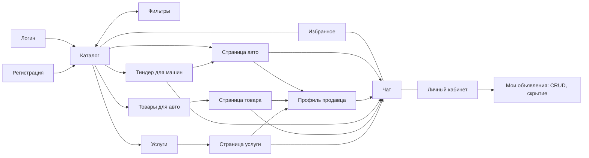
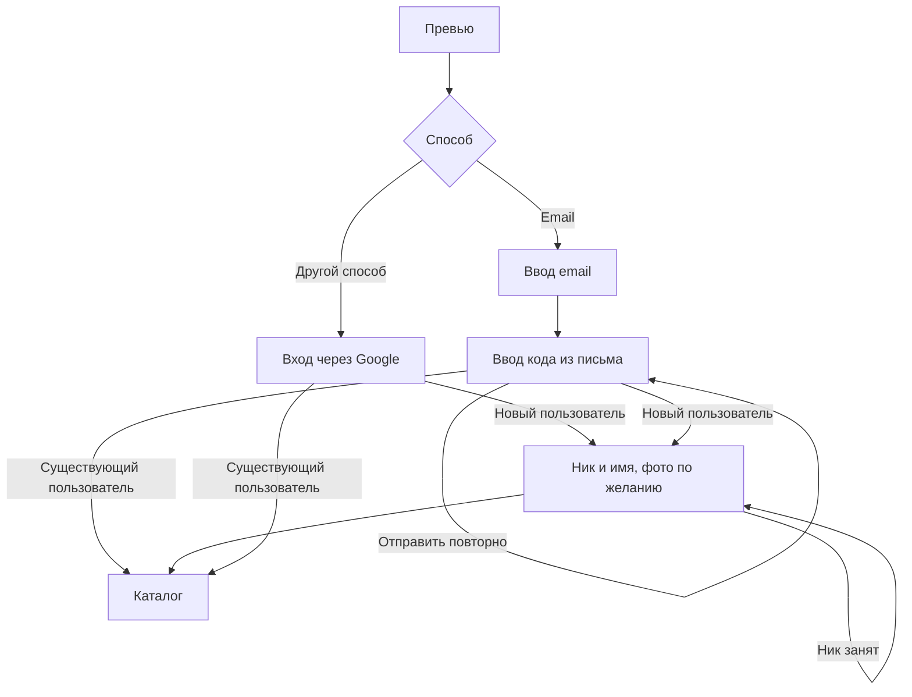

# Пользовательские сценарии

## Карта экранов

После входа пользователь попадает в каталог. Из каталога доступны фильтры, избранное, чат и личный кабинет. Из любой карточки авто можно перейти на страницу авто и в чат с продавцом.

## Вход и регистрация

Есть два способа: email с кодом из письма или Google. Механика входа и регистрации одинакова, при регистрации добавляется шаг выбора никнейма. Вход по телефону пока не делаем, хотя в прототипе он основной: экраны нужно перерисовать под email.

## Покупатель: от поиска до контакта

1. Открывает каталог.
2. Ищет по марке в строке поиска или открывает фильтры.
3. Сортирует выдачу.
4. Добавляет машины в избранное.
5. Открывает страницу авто, смотрит галерею и характеристики, копирует VIN, чтобы проверить его во внешнем сервисе.
6. Открывает профиль продавца и смотрит другие его объявления.
7. Пишет в чат по этому авто или звонит.

## Продавец: размещение и продажа

1. Открывает личный кабинет и создаёт объявление: фото, параметры из [справочника](05-filters.md), цена в удобной валюте (руб. ПМР, лей, USD, EUR), описание.
2. Объявление появляется в ленте.
3. Отвечает покупателям в чатах: каждый чат привязан к объявлению.
4. После продажи скрывает авто из глобального поиска или удаляет объявление. Получает системное уведомление о скрытии.

## Свайп-подбор

1. Открывает «Тиндер для машин», при желании задаёт фильтры.
2. Свайп вправо — авто попадает в избранное, влево — пропуск.
3. Может открыть подробности или сразу написать продавцу.
4. Просмотренные авто больше не появляются.
