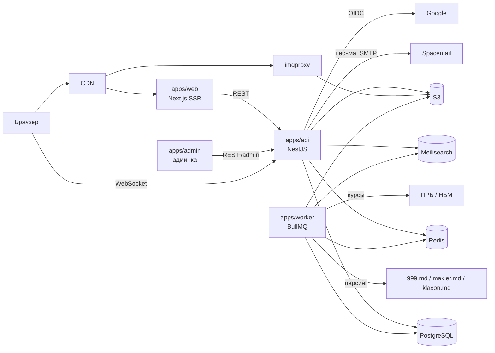
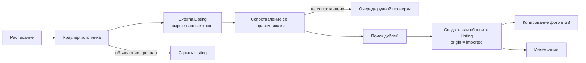

# Архитектура backend

Backend — модульный монолит: один API-сервис и один фоновый воркер в общем монорепозитории. Модули разделены по доменам и общаются через сервисы и доменные события, а не через чужие таблицы. Так проще запустить первый релиз и при необходимости вынести модуль в отдельный сервис.

## Общая схема



## Структура монорепозитория

```text
apps/
  web/        Next.js — сайт (см. docs/frontend)
  admin/      Vite + React — админка (см. docs/frontend/07-admin.md)
  api/        NestJS — REST API и WebSocket
  worker/     NestJS standalone — очереди: импорт, курсы, индексация, письма
packages/
  shared/     Zod-схемы, типы DTO, enum'ы, константы (валюты, лимиты)
  api-contract/  openapi.json — источник для генерации фронт-клиента через orval
  ui/         Дизайн-система: компоненты и токены, общие для сайта и админки
  db/         Prisma schema, миграции, сиды справочников
  config/     Общие настройки ESLint, TypeScript, Prettier
docs/
```

## Модули

| Модуль | Ответственность | Владеет сущностями |
| --- | --- | --- |
| `identity` | Регистрация и вход по email-коду и Google, сессии, никнеймы | User, AuthIdentity, Session, OtpCode |
| `profile` | Профиль, настройки (язык, тема, уведомления), публичный профиль | User (профильные поля), UserSettings |
| `catalog` | Справочники: марки, модели, поколения, категории товаров и услуг с атрибутами, регионы, города | Brand, Model, Generation, Category, CategoryAttribute, Region, City |
| `listings` | Объявления авто, товаров и услуг: CRUD, статусы, фото, скрытие | Listing, CarDetails, GoodsDetails, ServiceDetails, ListingPhoto |
| `search` | Индексация в Meilisearch, фильтры, фасеты, сортировка | Индекс `listings` (проекция) |
| `pricing` | Курсы валют, нормализация цен | ExchangeRate |
| `favorites` | Избранное | Favorite |
| `messaging` | Чаты по объявлениям, сообщения, прочтение, WebSocket | Conversation, Message |
| `notifications` | Уведомления на сайте и по email | Notification |
| `moderation` | Жалобы, блокировки пользователей, ручная проверка | Report, UserBlock |
| `import` | Парсинг площадок, сопоставление со справочниками, дубли, актуализация | ImportSource, ImportRun, ExternalListing |
| `media` | Загрузка фото, подписанные URL, связь с imgproxy | MediaFile |
| `admin` | API админки: эндпоинты `/api/v1/admin/*`, проверка ролей, журнал действий. Сам бизнес-логику не содержит — вызывает сервисы модулей выше | AdminAuditLog |

## Админка

- Отдельное фронт-приложение `apps/admin` ([frontend](../frontend/07-admin.md)) ходит в тот же API, но только в эндпоинты `/api/v1/admin/*`.
- Доступ: guard `@Roles('moderator' | 'admin')` на каждом контроллере админки. Роль хранится у пользователя (`User.role`).
- Каждое изменяющее действие в админке пишется в `AdminAuditLog` в той же транзакции, что и само изменение.
- Запуск парсинга из админки ставит задачу в очередь BullMQ `import.<source>` с флагом `manual`. Статус прогона админка читает из `ImportRun`, обновления — через polling раз в 5 с.
- Изменение справочника ставит задачу `search.reindex` для затронутых объявлений.
- Сессии сотрудников короче пользовательских: 12 часов без продления.
- В production админка доступна только с разрешённых IP или через VPN: ограничение на reverse proxy VPS для домена админки и для `/api/v1/admin/*`.

Правило зависимостей: модуль обращается к другому только через его публичный сервис. Прямые запросы в чужие таблицы запрещены.

## Ключевые потоки

### Вход по email-коду

```mermaid
sequenceDiagram
    participant B as Браузер
    participant A as API identity
    participant R as Redis
    participant E as Email
    B->>A: POST /auth/email/start {email}
    A->>R: rate limit по email и IP
    A->>R: сохранить хэш кода, TTL 10 мин, попыток 5
    A->>E: письмо с 6-значным кодом
    B->>A: POST /auth/email/verify {email, code}
    A->>R: проверить хэш и счётчик попыток
    A-->>B: Set-Cookie сессии; needsOnboarding=true, если нет ника и имени
    B->>A: POST /auth/complete-profile {username, name}
```

Google: стандартный OIDC Authorization Code + PKCE. Если email из Google совпадает с существующим аккаунтом, Google-идентичность привязывается к нему.

Лимиты и сессии:

- Код — 6 цифр, живёт 10 минут, 5 попыток ввода. В Redis хранится только хэш кода с секретом `OTP_PEPPER`, в ключах — хэш email.
- Повторная отправка на тот же email — не раньше чем через 60 секунд (таймер на экране кода). С одного IP — не больше 20 кодов в час. Превышение — 429 с `Retry-After`.
- Сессия — случайный токен в httpOnly cookie `ca_session`, в базе только его SHA-256. Сессия пользователя — 30 дней и продлевается при визитах, сессия сотрудника — 12 часов без продления.
- Вход деактивированного пользователя возвращает его в `active`. Заблокированный получает 403 `user_banned`; если срок блокировки истёк, блокировка снимается при входе.
- Коды ошибок входа: `otp_invalid` (в `errors` — `attempts_left:N`), `otp_expired`, `otp_too_many_attempts`, `otp_resend_too_soon`, `rate_limited`, `user_banned`, `username_taken`, `bad_origin`.

### Публикация и поиск объявления

1. `listings` сохраняет объявление в PostgreSQL в транзакции и публикует доменное событие `ListingPublished`.
2. Воркер забирает событие через outbox-таблицу и обновляет документ в Meilisearch.
3. `search` отдаёт ленту из Meilisearch, карточку — из PostgreSQL.

Outbox нужен, чтобы индекс не расходился с базой при сбоях.

### Цены и курсы

- Цена хранится как пара «сумма в минимальных единицах + валюта автора»: `price_amount`, `price_currency`.
- Воркер раз в день забирает курсы ПРБ и НБМ и пишет в `exchange_rates`. Рубль ПМР ↔ лей считаем кросс-курсом через USD.
- Для фильтра и сортировки в индексе хранится `price_usd` — пересчёт по последнему курсу. После обновления курсов воркер переиндексирует `price_usd` пакетно.
- Покупатель всегда видит цену в валюте автора.

### Импорт объявлений



- Идемпотентность: ключ — `(source, external_id)`. Изменения определяются по хэшу содержимого.
- Дубли: VIN, нормализованный телефон, перцептивный хэш фото, совпадение марка + модель + год + пробег + цена.
- Каждый источник — свой адаптер с общим интерфейсом `SourceAdapter`. Новый источник = новый адаптер.
- Мониторинг: доля ошибок, число объявлений за прогон, время с последнего успешного прогона. Алерт, если источник молчит больше суток.

### Чат

- Один `Conversation` на пару «объявление + покупатель». Продавец — автор объявления.
- Сообщение сохраняется в PostgreSQL, затем рассылается в комнату Socket.IO. Через Redis adapter работает на нескольких инстансах API.
- Если получатель офлайн, `notifications` создаёт уведомление на сайте и, с задержкой и группировкой, письмо.
- Для импортированных объявлений чата нет, пока автор не зарегистрирован.

## Безопасность

- Сессии: httpOnly, Secure, SameSite=Lax cookies; ротация refresh-токена; список активных сессий в профиле.
- CSRF: SameSite + проверка заголовка `Origin` для изменяющих запросов.
- Rate limit на вход, отправку кода, создание объявлений и сообщений.
- Загрузка фото: JPEG, PNG или WebP до 15 МБ. Браузер грузит файл напрямую в S3 по подписанному URL (живёт 15 минут), затем API проверяет файл, поворачивает по EXIF, уменьшает до 2560 px по длинной стороне, пересохраняет в JPEG (качество 85) без метаданных. Показываем через imgproxy (WebP/AVIF, подписанные URL в production). CORS бакета (метод PUT с адресов из `ALLOWED_ORIGINS`) API выставляет при старте.
- Персональные данные: телефоны в публичных ответах только для карточки объявления, не в списках.

## Окружения

| Окружение | Назначение |
| --- | --- |
| local | docker compose: PostgreSQL, Redis, Meilisearch, RustFS, imgproxy, Mailpit |
| staging | Копия прода с тестовыми данными, автодеплой из `develop` |
| production | Деплой по релизу. Схема веток — по [gitflow](../gitflow.md) |

staging и production работают на VPS Spaceship в docker compose: reverse proxy с TLS, сайт, админка, API, воркер, PostgreSQL, Redis, Meilisearch, RustFS, imgproxy. Бэкапы PostgreSQL и RustFS — ежедневно, хранятся вне сервера.
