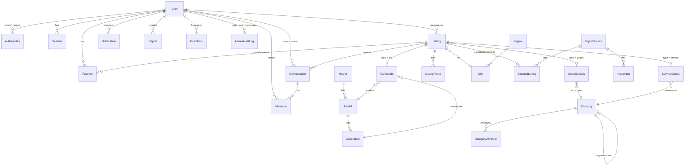
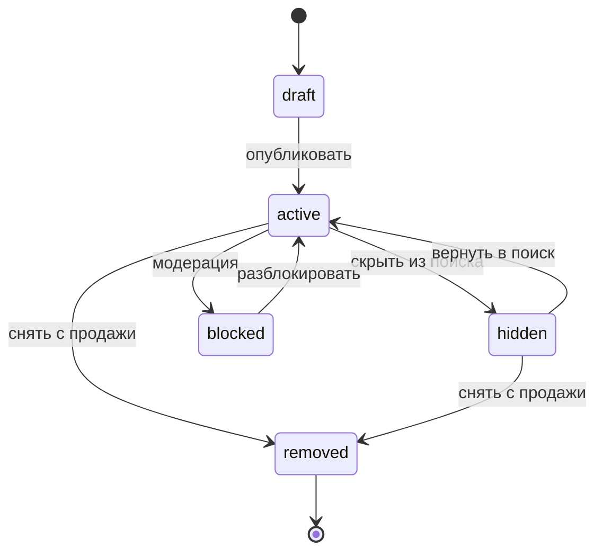

# Доменная модель

Центральная сущность — объявление (`Listing`). Есть три типа объявлений: авто, товар и услуга. У каждого типа своя таблица деталей. Пользователь один на все роли: он и покупает, и размещает.

## Контексты

| Контекст | Сущности |
| --- | --- |
| Identity | User, AuthIdentity, Session, OtpCode (в Redis) |
| Catalog | Brand, Model, Generation, Category, CategoryAttribute, Region, City |
| Listings | Listing, CarDetails, GoodsDetails, ServiceDetails, ListingPhoto |
| Pricing | ExchangeRate |
| Engagement | Favorite, SwipeAction (следующий этап) |
| Messaging | Conversation, Message |
| Notifications | Notification |
| Moderation | Report, UserBlock |
| Import | ImportSource, ImportRun, ExternalListing |
| Admin | AdminAuditLog (роль — поле `User.role`) |

## ER-диаграмма

## Сущности

### User

| Поле | Тип | Правила |
| --- | --- | --- |
| id | uuid v7 | |
| email | citext, unique, null | Обязателен у живого аккаунта: основной способ входа. null только при `status = deleted` |
| username | citext, unique, null | null только при `status = deleted`. 3–30 символов, `^[a-z](?!.*__)[a-z0-9_]*[a-z0-9]$`, уникальность без учёта регистра, не из стоп-листа ([правила](../analytics/03-requirements.md#1-вход-и-регистрация)) |
| username_changed_at | timestamptz, null | Время последней смены ника, для лимита «раз в 30 дней» |
| name | text, null | Обязательно, null только при `status = deleted` |
| avatar_media_id | uuid, null | Фото необязательно |
| phone | text, null | Только для связи, без подтверждения, формат E.164 |
| city_id | fk City, null | |
| locale | enum `ru` / `ro` | |
| theme | enum `light` / `dark` / `system` | |
| notify_email_messages, notify_email_system | bool | Письма о новых сообщениях и системных событиях, по умолчанию включены |
| status | enum `active` / `deactivated` / `banned` / `deleted` | `deactivated` — пользователь скрыл себя сам, вход возвращает `active`. `deleted` — необратимо ([правила](../analytics/03-requirements.md#деактивация-и-удаление-аккаунта)) |
| deactivated_at, deleted_at | timestamptz, null | При удалении `email`, `name`, `phone`, `avatar_media_id` очищаются, `username` освобождается, `AuthIdentity` удаляются |
| banned_until, ban_reason | timestamptz, text, null | Заполняются при блокировке из админки. Срок — 1, 7 или 30 дней; `banned_until = null` при `status = banned` — навсегда |
| role | enum `user` / `moderator` / `admin` | По умолчанию `user`. Меняет только администратор |
| created_at, updated_at | timestamptz | |

Пользователь считается зарегистрированным, когда заполнены `username` и `name`. До этого доступен только экран завершения профиля.

### AuthIdentity

Способ входа: `provider` (`email` / `google`), `provider_subject` (email или Google `sub`), `user_id`. Уникальность — `(provider, provider_subject)`. Паролей в модели нет.

### Session

`user_id`, `token_hash` (SHA-256 токена из cookie, сам токен не хранится), `user_agent`, `ip`, `is_staff`, `expires_at`, `last_seen_at`, `revoked_at`. Код входа (`OtpCode`) живёт только в Redis.

### Listing

| Поле | Тип | Правила |
| --- | --- | --- |
| id | uuid v7 | |
| type | enum `car` / `goods` / `service` | Определяет таблицу деталей |
| owner_id | fk User, null | null у импортированных, пока автор не забрал объявление |
| origin | enum `native` / `imported` | |
| status | enum, см. ниже | |
| title | text | У авто генерируется: «Марка Модель, год» |
| description | text | |
| price_amount | bigint, null | В минимальных единицах валюты; null, если «Договорная» |
| price_currency | enum `MDL` / `PRB` / `USD` / `EUR`, null | Валюту выбирает автор; `PRB` — код рубля ПМР внутри системы |
| price_negotiable | bool | |
| city_id | fk City | Регион выводится из города |
| contact_name, contact_phone | text, null | Для импортированных — из источника |
| published_at, hidden_at, removed_at | timestamptz, null | |
| version | int | Растёт при каждом изменении, для `If-Match` |
| created_at, updated_at | timestamptz | |

Статусы и переходы:

Для импортированных объявлений воркер ставит `hidden`, когда объявление пропало с источника.

### CarDetails

Значения `transmission`, `drive`, `body_type`, `color` — в [справочниках](../analytics/08-dictionaries.md#авто). Расхода, ПТС и «ограничений» в модели нет намеренно ([требования](../analytics/03-requirements.md#3-карточка-авто)).

`listing_id`, `model_id` (марка выводится из модели), `generation_id` (null), `custom_model_name` и `brand_id` (если выбрана модель «Другая»: марка из справочника, модель — текстом), `year`, `mileage_km`, `body_type`, `transmission`, `drive`, `fuel_types` (массив), `engine_volume_cc`, `power_hp`, `steering` (`left` / `right`), `color`, `registration` (`pmr` / `md` / `neutral` / `foreign`; в интерфейсе — «Учёт», вместо ПТС), `condition` (`new` / `used` / `needs_repair`), `owners_count`, `vin`, `exchange_possible`.

### ListingPhoto и MediaFile

- `MediaFile`: `owner_id`, `storage_key` (ключ в S3), `mime_type`, `size_bytes`, `width`, `height`, `uploaded` (файл дошёл до S3 по подписанному URL).
- `ListingPhoto`: `listing_id`, `media_id`, `position` (0 — главное фото), не больше 20 на объявление.

### GoodsDetails и ServiceDetails

- `GoodsDetails`: `category_id`, `condition` (`new` / `used`), `attributes` (JSONB), `compatible_models` (массив `model_id` + годы, для запчастей).
- `ServiceDetails`: `category_id`, `address`, `working_hours` (свободный текст, например «Пн–Сб 9:00–19:00»; расписание по дням и фильтр «работает сейчас» — следующий этап), `mobile_service` (выезд к клиенту), `served_brands` (массив `brand_id`).
- `attributes` проверяются по схеме атрибутов категории (`CategoryAttribute`): например, у шин — ширина, профиль, диаметр, сезон.

### Category и CategoryAttribute

- `Category`: `id`, `kind` (`goods` / `service`), `parent_id`, `slug`, `name_ru`, `name_ro`, `sort`.
- `CategoryAttribute`: `category_id`, `key`, `type` (`number` / `range` / `enum` / `multi_enum` / `bool` / `text`), `options`, `unit`, `filterable`, `required`. Атрибуты наследуются подкатегориями.

### Справочники авто

`Brand` → `Model` → `Generation`. Ведём сами, у каждой записи `slug`, `name`, `is_active`. Модель «Другая» — флаг в объявлении (`custom_model_name`), а не запись в справочнике.

### Region и City

`Region` (`name_ru`, `name_ro`, `country`: `pmr` / `md`; [список](../analytics/08-dictionaries.md#регионы)) → `City` (`name_ru`, `name_ro`, координаты центра для геолокации).

### ExchangeRate

`date`, `base` (`USD` / `EUR`), `quote` (`MDL` / `PRB`), `rate`, `source` (`nbm` / `prb`). Уникальность — `(date, base, quote)`.

### Favorite

`user_id`, `listing_id`, `created_at`. Уникальность — пара.

### Conversation и Message

- `Conversation`: `listing_id`, `buyer_id`, `seller_id` (копия `owner_id` на момент создания), `last_message_at`. Уникальность — `(listing_id, buyer_id)`.
- `Message`: `conversation_id`, `sender_id`, `body`, `attachments` (следующий этап), `read_at`, `created_at`.
- Писать нельзя, если один из участников заблокировал другого.

### Notification

`user_id`, `kind` (`new_message`, `listing_hidden`, `listing_blocked` и др.), `payload` (JSONB), `read_at`, `emailed_at`.

### Report и UserBlock

- `Report`: `reporter_id`, `target_type` (`listing` / `message` / `user`), `target_id`, `reason` (enum, набор зависит от `target_type`, [список](../analytics/08-dictionaries.md#причины-жалобы--reportreason)), `comment` (обязателен при `reason = other`), `status` (`new` / `resolved` / `rejected`).
- `UserBlock`: `blocker_id`, `blocked_id`.

### Импорт

- `ImportSource`: `code` (`999md` / `makler` / `klaxon`), `base_url`, `is_enabled`, `schedule`.
- `ImportRun`: `source_id`, `started_at`, `finished_at`, `status`, `stats` (JSONB: найдено, создано, обновлено, скрыто, ошибки).
- `ExternalListing`: `source_id`, `external_id`, `url`, `raw` (JSONB), `content_hash`, `last_seen_at`, `listing_id`, `match_status` (`matched` / `needs_review` / `duplicate`). Уникальность — `(source_id, external_id)`.

### AdminAuditLog

`actor_id` (сотрудник), `action` (`user.ban`, `listing.block`, `report.resolve`, `import.run`, `catalog.model.create`, `rates.manual_set`, `staff.role_change` и др.), `target_type`, `target_id`, `reason`, `diff` (JSONB: было → стало), `ip`, `created_at`. Только вставка: обновлять и удалять записи нельзя.

Дополнительные поля для админки в других сущностях:

- `Listing`: `blocked_reason`, `blocked_by`, `blocked_at`.
- `Report`: `resolved_by`, `resolved_at`, `resolution` (`listing_blocked`, `user_banned`, `rejected`), `resolution_comment`.
- `ImportRun`: `trigger` (`schedule` / `manual`), `triggered_by`.
- `ExchangeRate`: `source` дополняется значением `manual`, `set_by`.

### OutboxEvent

`type` (`listing.published`, `listing.updated` и др.), `payload`, `processed_at`, `attempts`. API пишет событие в той же транзакции, что и изменение; воркер забирает необработанные и обновляет поиск.

## Инварианты

1. У объявления ровно одна таблица деталей, и она соответствует `type`.
2. Если `price_negotiable = false`, то `price_amount` и `price_currency` обязательны.
3. В ленте и поиске только `status = active`.
4. Нельзя написать в чат по своему объявлению и по импортированному без владельца.
5. `username` меняется не чаще раза в 30 дней (по `username_changed_at`). Старый ник сразу свободен, редиректов со старого профиля нет. Регулярное выражение и стоп-лист лежат в `packages/shared` и общие для фронта и бэка.
6. Суммы денег — только целые числа в минимальных единицах, никаких `float`.
7. Любое изменение данных через админку имеет запись в `AdminAuditLog`. Блокировка пользователя или объявления и решение по жалобе требуют причину.
8. Сотрудник не может изменить собственную роль и заблокировать сам себя.
