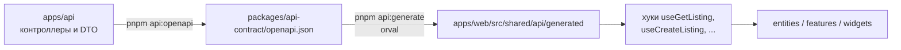

# API-клиент: orval + TanStack Query

Фронт не пишет запросы к API руками. Из OpenAPI-спецификации backend orval генерирует типы, функции запросов и хуки TanStack Query. Компоненты используют только сгенерированные хуки или обёртки над ними.

## Поток генерации



1. Backend описывает эндпоинты декораторами `@nestjs/swagger`. Скрипт `pnpm --filter api api:openapi` собирает спецификацию и пишет её в `packages/api-contract/openapi.json`.
2. `pnpm --filter web api:generate` запускает orval и перегенерирует `shared/api/generated`.
3. Спецификация и сгенерированный код коммитятся. Изменение API и фронта, который его использует, идут в одном PR.
4. CI запускает генерацию и падает, если после неё есть незакоммиченные изменения (`git diff --exit-code`). Так фронт не расходится с API.

## Конфигурация orval

`apps/web/orval.config.ts`:

```ts
import { defineConfig } from 'orval';

export default defineConfig({
  clickauto: {
    input: {
      target: '../../packages/api-contract/openapi.json',
      filters: { mode: 'exclude', tags: [/^admin-/] }, // API админки сайту не нужно
    },
    output: {
      mode: 'tags-split',                       // файл на каждый тег API: listings, auth, chat...
      target: 'src/shared/api/generated/endpoints',
      schemas: 'src/shared/api/generated/model', // типы DTO
      client: 'react-query',
      httpClient: 'fetch',
      clean: true,
      prettier: true,
      override: {
        mutator: {
          path: 'src/shared/api/http-client.ts',
          name: 'httpClient',
        },
        query: {
          useQuery: true,
          useSuspenseQuery: true,
          useInfinite: true,                    // для лент с курсором
          useInfiniteQueryParam: 'cursor',
          signal: true,                         // отмена запросов через AbortSignal
        },
      },
    },
  },
});
```

Скрипты в `apps/web/package.json`:

```json
{
  "scripts": {
    "api:generate": "orval --config ./orval.config.ts",
    "api:check": "pnpm api:generate && git diff --exit-code -- src/shared/api/generated"
  }
}
```

## HTTP-клиент (mutator)

Все сгенерированные запросы проходят через одну функцию `httpClient` в `shared/api/http-client.ts`. Она:

- подставляет базовый URL: на сервере — внутренний адрес API, в браузере — публичный `/api`;
- отправляет cookie сессии (`credentials: 'include'`), а на сервере пробрасывает cookie входящего запроса;
- ставит `Accept-Language` по текущей локали;
- превращает ответ с ошибкой в `ApiError` с полями `status`, `code`, `errors` из Problem Details;
- при 401 в браузере перенаправляет на вход.

```ts
export class ApiError extends Error {
  constructor(
    public status: number,
    public code: string,
    public errors: { field: string; code: string }[] = [],
  ) {
    super(code);
  }
}

export const httpClient = async <T>(url: string, init: RequestInit): Promise<T> => {
  const response = await fetch(`${getBaseUrl()}${url}`, {
    ...init,
    credentials: 'include',
    headers: { ...init.headers, ...(await getDefaultHeaders()) },
  });

  if (!response.ok) {
    const problem = await response.json().catch(() => ({}));
    throw new ApiError(response.status, problem.code ?? 'unknown_error', problem.errors);
  }

  return (response.status === 204 ? undefined : await response.json()) as T;
};
```

`getBaseUrl` и `getDefaultHeaders` различают сервер и браузер. Тип ошибки для TanStack Query объявляется глобально, чтобы `error` в хуках был `ApiError`:

```ts
declare module '@tanstack/react-query' {
  interface Register {
    defaultError: ApiError;
  }
}
```

## Настройка TanStack Query

`shared/api/query-client.ts`:

| Параметр | Значение | Почему |
| --- | --- | --- |
| `staleTime` | 60 с (справочники — 24 ч) | Лента и карточки не перезапрашиваются на каждый фокус окна |
| `gcTime` | 5 мин | |
| `retry` | 2 раза для 5xx и сетевых ошибок, 0 для 4xx | 4xx повторять бессмысленно |
| `refetchOnWindowFocus` | `true` для чата и уведомлений, `false` для остального | |

- В браузере один `QueryClient` на вкладку, создаётся в `providers.tsx`.
- На сервере — новый `QueryClient` на каждый запрос (через `cache()` из React), чтобы данные разных пользователей не смешивались.

## Как использовать

### Чтение данных в клиентском компоненте

```tsx
import { useGetListing } from '@/shared/api/generated/endpoints/listings/listings';

export function ListingPrice({ id }: Props) {
  const { data, isPending } = useGetListing(id);
  if (isPending) return <Skeleton className="h-6 w-24" />;
  return <Money value={data.price} />;
}
```

### Серверный рендеринг с предзагрузкой

Публичные страницы загружают данные на сервере и передают кэш клиенту, чтобы не было повторного запроса и мигания:

```tsx
// app/[locale]/(public)/cars/item/[id]/page.tsx
import { dehydrate, HydrationBoundary } from '@tanstack/react-query';
import { getGetListingQueryOptions } from '@/shared/api/generated/endpoints/listings/listings';

export default async function Page({ params }: PageProps) {
  const { id } = await params;
  const queryClient = getServerQueryClient();
  await queryClient.prefetchQuery(getGetListingQueryOptions(id));

  return (
    <HydrationBoundary state={dehydrate(queryClient)}>
      <ListingDetails id={id} />
    </HydrationBoundary>
  );
}
```

Метаданные страницы (`generateMetadata`) берут данные через тот же `queryClient.fetchQuery`, чтобы не делать второй запрос.

### Лента с курсором

```tsx
const query = useListListingsInfinite(filters, {
  query: {
    getNextPageParam: (lastPage) => lastPage.nextCursor ?? undefined,
    initialPageParam: undefined,
  },
});
```

`filters` берутся из URL (nuqs). Смена фильтра меняет ключ запроса, и лента грузится заново.

### Изменение данных

```tsx
const queryClient = useQueryClient();
const toggleFavorite = useAddFavorite({
  mutation: {
    onMutate: async ({ data }) => {
      // оптимистично отметить карточку, откатить в onError
    },
    onSettled: () => queryClient.invalidateQueries({ queryKey: getGetMyFavoritesQueryKey() }),
  },
});
```

- После мутации инвалидируются только связанные ключи. Ключи берутся из сгенерированных функций `get<Operation>QueryKey`, руками не пишутся.
- Ошибки валидации (`ApiError.errors`) раскладываются по полям формы через `setError`.
- Создание объявления и отправка сообщения передают заголовок `Idempotency-Key`.

## Правила

1. Сгенерированные файлы не редактируются. Нужно другое поведение — меняется API, конфиг orval или mutator.
2. Компоненты не вызывают `fetch` напрямую. Исключение — загрузка фото в S3 по подписанному URL.
3. Сгенерированные хуки используются в `entities` и `features`. Если вызов повторяется или требует настройки (оптимистичные обновления, `select`), его оборачивают в свой хук в слое: `entities/listing/api/use-listing.ts`.
4. Имена операций задаются на backend через `operationId` в `@ApiOperation`. Так имена хуков стабильны: `operationId: 'getListing'` → `useGetListing`.
5. Чат в реальном времени идёт через Socket.IO, а не через TanStack Query. Новые сообщения из сокета дописываются в кэш истории через `queryClient.setQueryData`.
