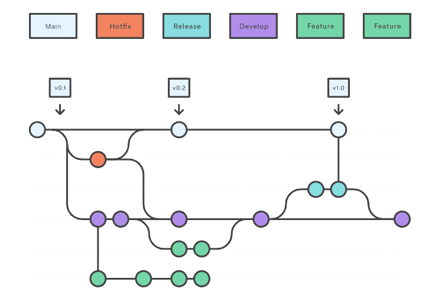

# Gitflow

Репозиторий работает по классическому gitflow — как все репозитории команды, даже если над проектом работает один человек. Источник: [карточка GitFlow в Trello](https://trello.com/c/jV6GA0ng/6-gitflow).



## Ветки

| Ветка | Откуда | Куда сливается | Назначение |
| --- | --- | --- | --- |
| `main` | — | — | Только релизный код. Каждый мерж в `main` — новая версия с тегом (`v0.1`, `v0.2`, `v1.0`) |
| `develop` | `main` | — | Основная ветка разработки. Сюда сливаются готовые фичи |
| `feature/*` | `develop` | `develop` | Новая функциональность и любые обычные задачи |
| `release/*` | `develop` | `main` и `develop` | Подготовка релиза: только исправления, версия, changelog |
| `hotfix/*` | `main` | `main` и `develop` | Срочное исправление в production |

## Именование веток

Префикс типа ветки, код задачи и пара слов о том, что делаем, через дефис, латиницей:

```text
feature/<КОД-ЗАДАЧИ>-<кратко-что-делаем>
hotfix/<КОД-ЗАДАЧИ>-<кратко-что-делаем>
release/<версия>
```

Пример из карточки: `feature/LUMEN-0001-ebu-alibabu`, `hotfix/LUMEN-0002-ebu-alibabu`.

Для релизов кода задачи нет, только версия: `release/0.2.0`.

## Порядок работы

1. Обнови `develop` и создай от неё ветку задачи: `git switch develop && git pull && git switch -c feature/<КОД>-<описание>`.
2. Коммить по Conventional Commits: `feat(listings): hide listing from search`.
3. Открой pull request в `develop`. Нужны зелёный CI и ревью.
4. Релиз: ветка `release/<версия>` от `develop`, исправления только в ней, затем мерж в `main` с тегом `v<версия>` и обратно в `develop`.
5. Хотфикс: ветка `hotfix/<КОД>-<описание>` от `main`, мерж в `main` с новым патч-тегом и в `develop`.

## Окружения

| Ветка | Куда деплоится |
| --- | --- |
| `develop` | staging, автоматически |
| `main` (тег) | production |
